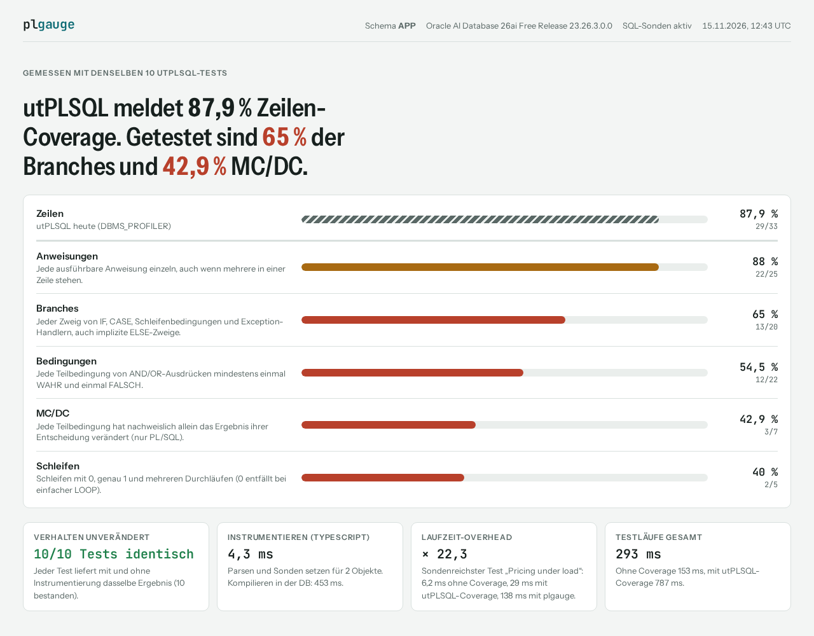

# @plgauge/coverage – branch, condition and MC/DC coverage for PL/SQL

utPLSQL measures coverage with `DBMS_PROFILER` and `DBMS_PLSQL_CODE_COVERAGE` and reports a **line** rate.
plgauge instead **instruments the source code**, the way JaCoCo or Istanbul do. Your existing utPLSQL tests
are the test runner; plgauge complements utPLSQL and does not replace it.

This package was formerly called plcov.

## What is measured

| Metric | What counts as covered |
|---|---|
| Statements | Each executable statement, counted separately even when several share a line |
| Branches | Each branch of `IF`, `CASE`, loop conditions and exception handlers, including implicit `ELSE` branches |
| Conditions | Each sub-condition of an `AND`/`OR` expression at least once TRUE and once FALSE; TRUE, FALSE and **NULL** are recorded separately |
| MC/DC | Each sub-condition has been shown to change the outcome of its decision on its own (PL/SQL only) |
| Loops | Loops run 0 times, exactly once and several times (0 does not apply to a plain `LOOP`) |

The tests are run with and without instrumentation, and plgauge checks on every run that they give the same results.

An example report is in [`examples/order_pricing/report/index.html`](../../examples/order_pricing/report/index.html):



## What line coverage misses: the demo

The same test suite (10 utPLSQL tests), measured on Oracle AI Database 26ai Free (23.26):

| Object | Lines (utPLSQL) | Statements | Branches | Conditions | MC/DC |
|---|---|---|---|---|---|
| `order_pricing` | **100 %** (23/23) | 84 % | **61 %** (11/18) | 50 % | **33 %** |
| `archive_orders` | 60 % | 100 % | 100 % | 100 % | 100 % |

- **`order_pricing`:** utPLSQL reports 100 %, although the branches `WHEN 'AT'` and `WHEN 'CH'` never ran and
  `if p_weight_kg > 20 then … end if;` (a single line) was never TRUE. The profiler counts a line as soon as
  its condition is evaluated.
- **MC/DC** finds missing test cases and proposes them concretely. The report shows, for example,
  "`p_vip` = TRUE, `p_amount > 1000` = FALSE → result FALSE".
- **`archive_orders`:** the exception handler is marked with `pragma coverage('NOT_FEASIBLE')`. plgauge excludes it;
  utPLSQL counts it as not covered.
- All 10 tests give the same result with and without instrumentation.

## Quick start

Prerequisites: Node.js 22 or newer and Docker or Podman. plgauge is not published on npm; run it from a checkout with `bin/plgauge`.

```bash
npm ci
# Oracle Free with utPLSQL 3.2.2 and a user with the required privileges; prints the connection URL
export PLGAUGE_DB=$(ci/setup-db.sh | tail -1)
# install the demo project (examples/order_pricing/plgauge.json) and measure it
bin/plgauge coverage examples/order_pricing --out out/order
```

The report is `out/order/index.html`. To measure a schema where the code is already installed, use a
connection config instead of a project: `bin/plgauge coverage --config coverage-config.json` (see
[Configuration](#configuration)).

## Commands

All commands are subcommands of `bin/plgauge`. `run` is the old name of `coverage` and still works.

| Command | Purpose |
|---|---|
| `coverage --config coverage-config.json [--out dir]` | Full run: baseline, utPLSQL coverage, instrument, test run, restore, report |
| `coverage <project> --db oracle://…` | The same for a project with `plgauge.json`: exactly its units and its tests |
| `instrument file.sql [--no-sql]` | Show offline what instrumented code looks like |
| `report coverage.json [--mutation run.json] [--out dir]` | Re-render the report folder; with mutation results, the combined report |
| `export coverage.json --format json\|cobertura\|sonar\|lcov\|junit [--src dir]` | Exchange format or CI formats; `--src` maps objects to source files |
| `merge a.json b.json … --out merged.json` | Merge runs (e.g. unit and integration tests) |
| `check file --min-stmt N --min-branch N --min-cond N --min-mcdc N` | CI thresholds; exit code 3 if one is missed |
| `corpus dir… [--db coverage-config.json]` | Parser robustness check on a corpus, optionally with a compile check |
| `deploy --config coverage-config.json files…` | Run SQL*Plus-style scripts (used for the demo) |
| `restore --config coverage-config.json [--list]` | Put back code that an aborted run left changed |
| `uninstall --config coverage-config.json` | Remove the runtime from the schema, see [Removing the runtime](#removing-the-runtime) |

Notes on `coverage`:

- **Output:** the report directory (default `plgauge-report`) receives:
  - `index.html`: the overview with the totals, one row per schema when several are measured (objects, objects
    without any hit, statements, branches, conditions, MC/DC and loops), and the object list;
  - `objects/<owner>.<name>.<type>.html`: one page per object with its source (lower case; characters other
    than letters, digits, `_`, `$`, `.` and `-` become `_`);
  - `report.css` and `report.js`, shared by all pages. The folder is static and opens from `file://`;
  - `coverage.json` (full run report) and `plgauge-coverage.json` (exchange format).

  At the end the run prints the totals, and one line per schema when there are several.
- **Thresholds:** `--min-stmt`, `--min-branch`, `--min-cond` and `--min-mcdc` also work directly on `coverage`.
- **Diff mode:** `--diff origin/main` (on `coverage` and `check`) applies the thresholds only to lines changed since
  the merge base. It needs the source files: a project, or `--src dir`.
- **Projects:** `--skip-install` skips the project's install scripts.
- **Exit codes:** 3 when a threshold is missed, 4 when test results differ with instrumentation, 1 when objects
  could not be restored (then run `restore`).

## Configuration

### `coverage-config.json`

Example: [`examples/order_pricing/coverage-config.json`](../../examples/order_pricing/coverage-config.json).

| Key | Meaning |
|---|---|
| `user`, `password`, `connectString` | Database connection. `PLGAUGE_PASSWORD` overrides `password` |
| `schema` | Schema whose code is measured |
| `tests` | utPLSQL paths to run, e.g. `["demo"]` |
| `include`, `exclude` | Optional regular expressions (case-insensitive), tested on `NAME` and on `OWNER.NAME`: `^PRICING$` picks an object by name, `^CORE\.` all objects of schema `CORE` (in JSON `"^CORE\\."`), `^CORE\.PRICING$` one object. An object is measured when `include` matches either form and `exclude` matches neither |
| `sqlProbes` | Instrument SQL as well; `"auto"` = from 23ai on |
| `perTest` | Record which test reaches which probe (default `true`) |
| `baselineRuns` | Test runs without coverage before measuring (default 2) |
| `schemas`, `runtimeSchema` | Measure several schemas, see [Multiple schemas](#multiple-schemas) |

### Projects (`plgauge.json`)

A project is a directory with `plgauge.json` (`install`, `mutate`, `tests`), the same file the mutation tool reads.
`bin/plgauge coverage <dir> --db oracle://…` runs the install scripts and measures exactly the units of the
`mutate` files with the project's `tests`. No `coverage-config.json` is needed.

### Environment variables

| Variable | Used by |
|---|---|
| `PLGAUGE_DB` | Database URL (`oracle://user:pw@host:port/service`) for the CLI, instead of `--db`. For a comma-separated list, `coverage` uses the first URL |
| `PLGAUGE_PASSWORD` | Overrides the password of a `--config` file |
| `PLGAUGE_COV_DB`, `PLGAUGE_LIB_SCHEMA` | Tests only (see [Tests](#tests)) |

## How a run works

1. A warm-up run, then `baselineRuns` test runs **without** coverage (reference for results and run time).
2. A test run **with** utPLSQL coverage (line rate for comparison).
3. Fetch the source through `DBMS_PREPROCESSOR` (conditional compilation resolved), instrument it and compile it with
   the original settings (`plsql_optimize_level`, `plsql_code_type`, `plsql_ccflags`, …). If an object does not
   compile, the original stays active.
4. Test run on the instrumented code; collect the probes.
5. Restore the originals (also on errors, in a `finally`) and recompile invalidated dependents.
6. Compare the test results of steps 1 and 4 and write the report.

Before instrumenting, each original is saved in a journal; a new run (or `restore`) first restores whatever an
aborted run left behind.

## What instrumented code looks like

```sql
-- Original
if p_vip and p_amount > 1000 then

-- Instrumented (same line, no line breaks inserted)
cov$.s(1);if cov$.d(1,cov$.o(1) and (cov$.c(1,1,p_vip) and cov$.c(1,2,p_amount > 1000))) then
```

- `s` counts statements; `o` / `d` open and close a decision (truth vector for MC/DC); `c` / `n` record a sub-condition.
- **Short-circuit evaluation is preserved exactly.** Oracle evaluates conditions in `IF`/`WHILE`/`WHEN` as jump code:
  NULL stops an `AND` just like FALSE. The probes record the real value (including NULL) and return it with the right
  polarity: `c` maps NULL to FALSE, `n` (under `NOT`) maps it to TRUE. Without this, functions with side effects would
  be called more often. The equivalence test (`packages/coverage/test/db.test.ts`) found exactly this bug.
- **SQL probes (23ai/26ai only):** `CASE` in select lists, `SET` and `VALUES` is instrumented with `BOOLEAN` probes in SQL.
  - Not in `WHERE`/`ON`/`HAVING`, on purpose: it would change the execution plan.
  - Not in `GROUP BY`, because the expressions must stay identical.

## Per-test coverage and the exchange format

plgauge attributes every hit to the running utPLSQL test:

- The test is read via `SYS_CONTEXT('UT3_INFO', 'TEST_NAME')`, once per statement probe, within a single `ut_runner.run`.
- Hits outside a test (`beforeall`/`afterall`) go to a separate setup entry `#owner.package`.
- In the report, the hit count of a line shows the tests that reach it in a tooltip.

`plgauge-coverage.json` (format `plgauge-coverage/1`) is meant for other tools, e.g. the oracle mode of `plgauge mutate`.

- **Coordinates:** as in ALL_SOURCE, 1-based. Line 1 is the line with the type keyword (`package body …`), without `CREATE`.
- **Tests:** paths in lower case (`owner.package.procedure`). Possible statuses:

  | Status | Meaning |
  |---|---|
  | `passed`, `failed`, `error`, `skipped` | As reported by utPLSQL |
  | `excluded` | Already failing without instrumentation |
  | `flaky` | Result changes without instrumentation |
  | `unknown` | No result recorded |

- **Per object:**
  - `sourceSha256` (post-processed) and `rawSha256` (raw ALL_SOURCE)
  - `lines` (hits and test indices)
  - `branches` (with the range of the condition)
  - `conditions` (column range, tests split by TRUE, FALSE and NULL)
  - `notMeasured`
- **Optional additions** (older readers ignore them):
  - `statements` with line and column range and tests (the mutation tool uses them to select tests)
  - on `branches`: the construct ID and `nf`
  - on `conditions`: hit counts and MC/DC
  - per object: `metrics` with the measured rates

## Flaky tests

Before measuring, the tests run twice without coverage (`baselineRuns`), then once with utPLSQL coverage. Every run
starts with fresh package state (`DBMS_SESSION.RESET_PACKAGE`), like the run on the freshly compiled instrumented code.

A test whose result changes between these runs is flaky:

- it appears in the export with status `flaky`;
- it does not count for the "same behaviour with and without instrumentation" check;
- the run names every test whose result differs.

## CI

- **Formats:** Cobertura (GitLab, Jenkins, Azure DevOps), SonarQube Generic Coverage, LCOV and JUnit.
  - These formats only know lines and branches. Statement lines become lines; the branches of IF, CASE, loops and
    handlers become branches.
  - Derived branches (THEN and the implicit ELSE) sit on the line of their condition.
  - Sub-conditions and MC/DC remain in the JSON and the report.
- **Paths:** measurement happens on database objects. `--src` finds the units in the source files (using the parser)
  and converts ALL_SOURCE lines into file lines. Objects without a match get virtual paths like
  `schema/package_body/name.sql`.
- **Merging:** objects must have the same source (`rawSha256`). Hits are added up and test lists are united. After a
  merge, MC/DC counts as satisfied if one run satisfied it (the vectors of different runs are not combined).
- **Diff mode:** a changed line belongs to the innermost statement around it, not to the enclosing IF.
- **Templates:** `ci/templates/github-actions.yml` and `ci/templates/gitlab-ci.yml`. `ci/setup-db.sh` starts
  Oracle 23ai Free with utPLSQL 3.2.2 and a user with the required privileges.

## Multiple schemas

With `"schemas": ["APP_CORE", "APP_UTIL"]`, one run measures the objects of several schemas.

- The runtime package `cov$` and the hit table stay in the schema of the connected user (or `runtimeSchema`).
- Instrumented code in other schemas calls it qualified (`user.cov$`); the run grants `EXECUTE` on `cov$` to those schemas
  and revokes it at the end. A schema whose instrumented code could not be restored keeps its grant until
  `plgauge restore`, so that code stays valid.
- Code is compiled in the object's own schema.
- The tests (`tests`) run with their owner's privileges, as usual.
- Without `schemas`, runtime and objects live in `schema`.

Minimum privileges of the connected user:

| Privilege | Needed for |
|---|---|
| `CREATE ANY PROCEDURE` (`CREATE ANY TYPE`, `CREATE ANY TRIGGER` for type bodies and triggers) | Compiling instrumented code and the original in other schemas |
| `EXECUTE ANY PROCEDURE` or `EXECUTE` on the objects | Seeing the source in `ALL_SOURCE` and running the tests |
| Own: `CREATE PROCEDURE`, `CREATE TABLE` | `cov$`, hit table, restore journal |

## Removing the runtime

A run leaves its runtime in the runtime schema for the next run: the package `cov$` and the tables
`plgauge_hits`, `plgauge_runs`, `plgauge_journal` and `plgauge_lock` (the last two are shared with mutation runs).
`plgauge uninstall --config coverage-config.json` removes them, together with the logoff trigger of an aborted run
and every `EXECUTE` grant on `cov$`. With `--db` (or `PLGAUGE_DB`) instead of a config, it works on the user's own
schema and the session's `CURRENT_SCHEMA`.

- It refuses while the restore journal has entries: run `plgauge restore` first.
- It takes the run lock, so it fails while a run is in progress.
- A second `uninstall` finds nothing and changes nothing.

## Robustness: the corpus

`corpus/fetch.sh` downloads public PL/SQL code at fixed commits into `corpus/.cache/`, among them utPLSQL 3.1.14, Logger,
alexandria-plsql-utils and pljson. The code is not checked in; check the licences per file.

```bash
corpus/fetch.sh
bin/plgauge corpus corpus/.cache/*                        # offline: parse, instrument, check line count
bin/plgauge corpus corpus/.cache/* --db corpus/db.json    # additionally: compiles instrumented wherever the original compiles
```

Results on utPLSQL 3.1.14, Logger, alexandria-plsql-utils and pljson:

- 747 files, **280/280 bodies** instrumented offline (0.6 s), including two Latin-1 files.
- In the database, **174/174** bodies also compile instrumented: all bodies whose original compiles in the empty test schema.
- The corpus found two bugs (`if(` / `not(` directly before a parenthesis); both are now covered by tests.

For files, a separate preprocessor (`packages/core/src/preprocess.ts`) keeps the last `$IF` branch and replaces the rest
with spaces. The database run still uses `DBMS_PREPROCESSOR`.

## Performance

- **TypeScript is fast enough.** Parsing and instrumenting the demo takes ~5 ms. The run time is spent entirely in the
  database (compiling ~50–120 ms, test run), so the implementation language does not matter for performance.
- **Per-test coverage** adds about 50 % in the load test (103–133 ms instead of 78–84 ms), because `SYS_CONTEXT` is read
  once per statement.
- **Database overhead:** probes only count in package memory (associative arrays with integer keys). Hits are written
  once at the end in an autonomous transaction. In the probe-heaviest test (20,000 calls of a trivial function)
  plgauge takes 48–90 ms, compared with 6 ms without coverage and 30–50 ms with utPLSQL's own coverage. For code with
  a real SQL share the relative overhead is much smaller.
- The runtime package `cov$` is compiled with `plsql_optimize_level = 3`, natively where allowed.

## Tests

```bash
npm test                                                   # parser, instrumentation, MC/DC (offline)
PLGAUGE_COV_DB=demo/demo@localhost:1521/FREEPDB1 npm test        # additionally the equivalence test against a real DB
npm run typecheck
```

## Limitations

- **Hits from other sessions.** During the measuring run, the run is registered in `plgauge_runs`. Another session of
  the schema user that executes instrumented code (e.g. a scheduler job started by a test) counts under the entry
  `#background`. It writes its hits every 1000 statements and at logoff:
  - via the trigger `cov$_logoff`, which needs `CREATE TRIGGER` and exists only during the run (one left by an
    aborted run is removed by the next run or by `plgauge restore`);
  - the run waits up to one minute for running jobs.

  Sessions of other users, and parallel query slaves that execute fewer than 1000 statements, are still lost.
- **Not measured:** dynamic SQL (the `EXECUTE IMMEDIATE` statement itself counts), code encrypted with `wrap`, and
  trigger `WHEN` clauses (Oracle allows no PL/SQL calls there; whether the body ran shows in its first statement).
  CASE expressions in conditions and in loop bounds are not measured either. The report lists such places under
  "Not measured".
- **Measured** (listed here for clarity):
  - compound triggers: each timing point is treated like a block;
  - simple `CASE x WHEN …` expressions: a branch probe before each result,
    `THEN CASE WHEN cov$.bt(id) THEN result END`; the probe always returns TRUE, so type and evaluation order are kept;
  - the `WHEN`/`WHILE` filters of FOR loops (21c) are measured as decisions.
- **Parser.** The parser (`@plgauge/core`) reads structure, SQL and expressions; anything it does not understand is
  treated as an opaque region. If it cannot understand the structure of an object, the object is skipped and marked in
  the report.
- **Loop metrics are an approximation.** Recursion inside the same loop counts iterations inaccurately: the counter is
  per loop, not per call, so a recursive call in the body closes the outer count. In an explicit cursor loop
  (`LOOP FETCH …; EXIT WHEN c%NOTFOUND; …`) every entry into the body counts, including the one that ends at the first
  `EXIT`: "once" there means "no row".
- **Result caching.** For functions with `RESULT_CACHE` (and results Oracle reuses for `DETERMINISTIC` functions
  within a statement), the probes do not run when the result comes from the cache, so the hits are too low.
- **`DBMS_SESSION.RESET_PACKAGE` in a test** discards the hits collected so far; the run warns about it.
